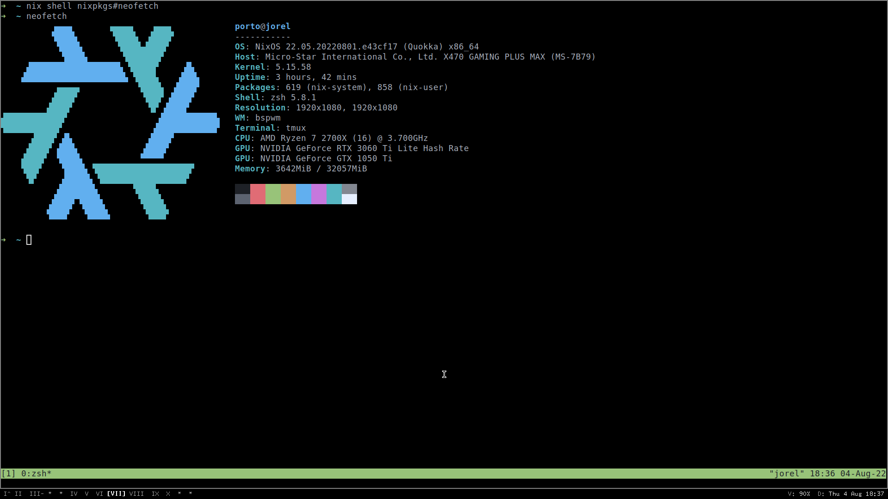

# dotfiles

One Nix flake for all my machines: macOS system config with
[nix-darwin](https://github.com/nix-darwin/nix-darwin), user config with
[home-manager](https://github.com/nix-community/home-manager), NixOS hosts,
and the homelab cluster manifests.



## Usage

```
$ ./setup [--update] [host]
```

`host` defaults to the machine's short hostname. `--update` bumps every flake
input first. The script picks the right tool for the host:

| Host | Kind | Applied with |
|-|-|-|
| boris | macOS, aarch64 | nix-darwin, with home-manager as a module |
| zaza | macOS, x86_64 | standalone home-manager |
| jorel, klong | Linux | standalone home-manager |

On a Mac, one run applies the system (Homebrew, macOS defaults, fonts, Touch
ID sudo) and the home-manager config together.

### New Mac

1. Install Nix with the [Determinate installer](https://determinate.systems/nix-installer/)
   (nix-darwin is configured with `nix.enable = false` to leave Nix to it).
2. Install [Homebrew](https://brew.sh).
3. Clone this repo to `~/www/portothree/dotfiles`.
4. Add `hosts/<host>/darwin.nix` and `profiles/<host>/home.nix` (copy boris),
   and a `darwinConfigurations.<host>` entry in `flake.nix`.
5. Copy the Bitwarden secure note "dotfiles secrets.env" to
   `~/.config/dotfiles/secrets.env` and `chmod 600` it, so the first switch
   fills in the Zed MCP tokens (see [Secrets](#secrets)).
6. Run `./setup <host>`. It bootstraps nix-darwin on the first run and sets
   the machine's hostname, so later runs need no argument.

Then the logins and settings nothing here can do:

1. Approve the Aperture proxy's tailnet login: open the URL in
   `~/.local/state/ts-unplug/ts-unplug.log` (see [Aperture](#aperture));
   without it Claude Code and Codex can't reach a model.
2. Install Claude Code with its native installer
   (`curl -fsSL https://claude.ai/install.sh | bash`) and run `/login` with
   the Max account.
3. Sign in to ChatGPT in the ChatGPT app (Codex uses that login).
4. Restore Raycast with Cloud Sync, sign in to its Claude and ChatGPT
   subscriptions, and set Claude's executable path (see [Raycast](#raycast)).

On the first switch, nix-darwin refuses to overwrite `/etc` files it doesn't
own (for example `/etc/zshrc` or `/etc/bashrc`); rename them to
`*.before-nix-darwin` as it asks. Files home-manager finds in `$HOME` are
moved aside with the same suffix.

Homebrew never uninstalls anything here (`onActivation.cleanup` stays
`"none"`), so packages missing from the list are left alone.

Apps installed by hand before they were added as casks make `brew bundle`
fail on the first switch. Hand them over to Homebrew once:

```
$ brew install --cask --adopt arduino-ide chatgpt claude jamie ledger-wallet \
    microsoft-teams notion notion-calendar obsidian openvpn-connect raycast \
    steam telegram vlc zed zen
```

App Store apps (`masApps`) need you to be signed in to the App Store.

### Not managed here

No Nix option or Homebrew cask covers these; install them by hand.

- Setapp (the `setapp` cask installs the client): CleanMyMac, CleanShot X,
  JoyCast, Lungo, Proxyman, TablePlus, TripMode, Tripsy
- Direct downloads: Delta (Zed), Intelbras SIMPlay, IBKR Desktop
- `npm -g`: `@google/gemini-cli` (nixpkgs lags far behind), and
  `ledger-reports`/`ynab-to-ledger` linked from the memex repo
- `cargo install`: `abtop`, `portogrrs`; `go install`: `aperture`
- `~/.local/bin`: `claude` and `basic-memory` from their own installers,
  `camo-studio`

## Host names

Machines are named after characters from the Brazilian animated series
[Irmão do Jorel](https://irmaodojorel.fandom.com/pt-br/wiki/Irm%C3%A3o_do_Jorel_Wiki).
New machines, VMs and test fixtures follow the same scheme, using a
character not taken yet from the [character list](https://irmaodojorel.fandom.com/pt-br/wiki/Categoria:Personagens).

| Host | Character | Machine |
|-|-|-|
| boris | [Bóris](https://irmaodojorel.fandom.com/pt-br/wiki/B%C3%B3ris) | MacBook Pro M3 (2023) |
| zaza | [Zazá](https://irmaodojorel.fandom.com/pt-br/wiki/Zaz%C3%A1) | MacBook Pro i5 (2020), work |
| jorel | [Jorel](https://irmaodojorel.fandom.com/pt-br/wiki/Jorel) | Main workstation, NixOS (`jorel-wsl`: WSL on it) |
| klong | [Klong](https://irmaodojorel.fandom.com/pt-br/wiki/Klong) | ThinkPad X1 Nano, NixOS |
| juju | [Vovó Juju](https://irmaodojorel.fandom.com/pt-br/wiki/Vov%C3%B3_Juju) | Huawei Matebook D14, NixOS |
| lara | [Lara](https://irmaodojorel.fandom.com/pt-br/wiki/Lara) | NixOS VM on Proxmox (k3s) |
| yuki | [Yuki](https://irmaodojorel.fandom.com/pt-br/wiki/Yuki) | Nothing Phone (1) |
| syd | [Syd Vinicius](https://irmaodojorel.fandom.com/pt-br/wiki/Syd_Vinicius) | Mac (home-manager only) |
| oraculo | [Oráculo](https://irmaodojorel.fandom.com/pt-br/wiki/Or%C3%A1culo) | microvm in `infrastructure/staging` |
| gesonel | [Gesonel](https://irmaodojorel.fandom.com/pt-br/wiki/Gesonel) | NixOS VM in the `home-vm` test (user `nico`, after [Nico](https://irmaodojorel.fandom.com/pt-br/wiki/Nico)) |

## Tests and CI

`nix flake check` runs everything for the current system:

| Check | What it does |
|-|-|
| `pre-commit-check` | nixfmt, statix, deadnix, shellcheck and gitleaks (also installed as a git hook by `nix develop`) |
| `darwin-boris` (aarch64-darwin) | Builds the full boris system |
| `home-jorel`, `home-klong` (x86_64-linux) | Build the Linux home configs |
| `home-vm` (x86_64-linux) | Boots a NixOS VM, applies the home-manager modules (agents, zsh, neovim, tmux, git) for the test user `nico` and checks the result |

macOS has no VM test, so CI ([`.github/workflows/ci.yml`](.github/workflows/ci.yml))
switches a throwaway macOS runner to `darwinConfigurations.ci` (boris for
the runner user, without Homebrew and App Store installs) and runs
`tests/darwin-smoke.sh`. `tests/brew-check.sh` checks that every tap,
formula and cask still exists; run it before a switch after upstream
renames. CI also scans the whole git history for secrets with gitleaks,
which catches a token added in one commit and removed in a later one.
Renovate's `flake.lock` update PRs go through the same CI.

## Layout

| Path | What |
|-|-|
| `flake.nix` | Every machine's entry point |
| `hosts/<host>/` | System config: `darwin.nix` (nix-darwin) or `configuration.nix` + `hardware-configuration.nix` (NixOS) |
| `hosts/*.nix` | Shared NixOS modules (`common.nix`, `zsa.nix`, `platformio.nix`) |
| `profiles/<host>/home.nix` | home-manager config per host |
| `modules/programs/` | home-manager modules (`modules.<name>.enable`) |
| `modules/nixos/` | NixOS modules |
| `config/` | Dotfile sources, grouped by category: `ai`, `comms`, `desktop`, `dev`, `editors`, `media`, `system`, `terminal` |
| `cluster/` | k3s cluster manifests, applied by Flux from git |
| `infrastructure/` | microvm definitions |
| `docs/homelab.md` | Homelab notes and network diagram |

The NixOS hosts (jorel, klong, juju, lara), juju's incomplete home profile, `hosts/zaza/darwin.nix`, the
cluster and the microvms came from the former
[portothree/homelab](https://github.com/portothree/homelab) repo, with its
history. They date from nixpkgs 24.05 and aren't wired into the flake yet;
they'll need updating when those machines come back.

# AI (coding agents, skills, subagents, harness config)

This repo is the source of truth for coding agent config, deployed by the
`ai.agents` home-manager module (`modules/programs/ai/agents.nix`) through
home-manager's [`programs.claude-code`](https://nix-community.github.io/home-manager/options.xhtml#opt-programs.claude-code.enable):

| Source | Deployed to |
|-|-|
| `config/ai/agents/.agents/skills/<name>/` (vendored) | `~/.claude/skills/<name>`, `~/.agents/skills/<name>` (one link per skill, so other skills can sit next to them) |
| `config/ai/AGENTS.md` (shared instructions) | `~/.agents/AGENTS.md`, Zed `~/.config/zed/AGENTS.md` and Codex `~/.codex/AGENTS.md` (live links) |
| `config/ai/claude/.claude/CLAUDE.md` (imports the shared file, plus Claude-only rules) | `~/.claude/CLAUDE.md` (store copy) |
| `config/ai/claude/.claude/settings.json` | `~/.claude/settings.json` (live link) |
| `config/ai/claude/.local/bin/claude-aperture` | `~/.local/bin/claude-aperture` (see [Aperture](#aperture)) |
| `config/ai/aperture/config.hujson` | Not deployed; pasted into the Aperture admin UI (see [Aperture](#aperture)) |
| `config/ai/snippets.md` | Not deployed; prompt snippets kept in Raycast (PR review, cross-review between agents) |
| `config/ai/codex/.codex/config.toml` | `~/.codex/config.toml` (written file, see [Secrets](#secrets)) |
| `config/editors/zed/.config/zed/settings.json` (template, `modules.zed`) | `~/.config/zed/settings.json` (rendered file, see [Secrets](#secrets)) |

Live links are out-of-store (`mkOutOfStoreSymlink`) and point at this
checkout, so Claude Code can still write `settings.json` (plugins, `/config`)
and those changes show up as a git diff. Everything else needs a
`home-manager switch` to apply. Claude Code itself is installed with its
native installer (`package = null`).

Enable it per profile:

```nix
modules.ai = {
  agents.enable = true;
  # dotfilesPath = "/path/to/dotfiles"; # default: ~/www/portothree/dotfiles
};
```

On a machine that already has these files, move them out of the way on the
first switch: `home-manager switch -b backup --flake .#<host>`.

### Basic Memory

Notes live in [Basic Memory](https://basicmemory.com) (MCP server
`basic-memory`). A `SessionStart` hook in `settings.json` tells Claude to run
the `memory-continue` skill before its first reply, so each session starts
with the relevant notes loaded. Writing follows the `memory-capture` and
`memory-notes` skills: search first, then update an existing note instead of
adding a new one. A `UserPromptSubmit` hook reminds Claude on each prompt to
update the thread's note with `memory-capture` once something is settled; it
replaced an older hook that wrote a new transcript note per exchange. Read and write tools are pre-approved in `settings.json`.

A second `SessionStart` hook, `config/ai/claude/.claude/hooks/basic-memory-health.sh`,
checks the default Basic Memory project (from `~/.basic-memory/config.json`).
When it finds 5 or more transcript-style notes, a ticket split across 8 or
more notes, or 35 or more top-level folders, it prints a one-line hint and
Claude suggests running `memory-curate`. It stays silent otherwise.

### Aperture

[Tailscale Aperture](https://tailscale.com/docs/aperture) is an LLM gateway
on the personal tailnet at `p8s.tailea386.ts.net`. It logs every model request
under the caller's Tailscale identity, which gives one view of usage across
tools. It runs in [passthrough mode](https://tailscale.com/docs/aperture/how-to/use-passthrough-mode):
Claude Code and Codex sign in to their subscriptions (Claude Max, ChatGPT) and
Aperture forwards those OAuth tokens unchanged. No API key is stored in
Aperture or here.

| Client | Setting | Gateway path |
|-|-|-|
| Claude Code | `env.ANTHROPIC_BASE_URL` in `settings.json` | `/v1/messages` |
| Codex (CLI, ChatGPT app, Zed) | `model_provider = "aperture"` in `config.toml` | `/codex/responses` |
| Raycast AI, ChatGPT subscription | Runs the Codex CLI, so `config.toml` covers it | `/codex/responses` |
| Raycast AI, Claude subscription | Claude "Advanced > Executable path" set to `~/.local/bin/claude-aperture` | `/v1/messages` |

Requests show up at `http://localhost:8787/sessions`; the admin
dashboard is at `/admin/`.

Every client uses `http://localhost:8787`, not the gateway hostname. That's
[ts-unplug](https://tailscale.com/docs/aperture/connect-outside-tailnet),
packaged and run at login by `modules/programs/ai/aperture.nix`
(`modules.ai.aperture.enable`, a home-manager `launchd` agent). It joins the
personal tailnet as its own node and forwards to the gateway, so the agents
keep working when the Tailscale app is signed in to another tailnet (e.g. the
opencoreos one). First run: open the login URL it writes to
`~/.local/state/ts-unplug/ts-unplug.log` with the personal account, and
approve the node if the tailnet asks. Its tailnet session lives in that state
folder; keep it out of backups you share. A DNS filter that blocks
`controlplane.tailscale.com` (NextDNS does by default with some lists) stops it
signing in; allowlist `tailscale.com`.

Aperture names the agent from the request's `User-Agent` (Claude) or
`originator` (Codex) header. To tell launchers apart, Zed's `agent_servers`
set `env` so their sessions show as `zed` (`ANTHROPIC_CUSTOM_HEADERS` with a
`User-Agent` for Claude, `CODEX_INTERNAL_ORIGINATOR_OVERRIDE` for Codex), the
way Raycast uses one name for both; the model column tells them apart.
Raycast shows as `raycast-ai-chat`, the Claude Code CLI as Claude Code and
the Codex CLI as Codex.

The gateway also serves an MCP server at `/v1/mcp`, added to Zed (all MCP
servers live in Zed's settings; Codex and Claude Code run inside Zed get them
from there).
Its `aperture_list_sessions`, `aperture_get_session` and
`aperture_get_session_request` tools read back recorded sessions, so one agent
can read what another did, e.g. "read Aperture session `ancc_…` and review the
branch against it". Claude Code requests only carry the new messages of each
turn, so a full transcript means reading every request of the session.
Sessions are kept 30 days and only their owner can read them.

Aperture is hosted by Tailscale, so its config lives in its admin UI, not on
disk. `config/ai/aperture/config.hujson` is the copy kept in git. To push it:
paste it into `/admin/config` and save (saving validates it). To pull the live
one: `curl -s http://localhost:8787/api/config | jq -r .config`.

- A model missing from a provider's `models` list doesn't pass through: Claude
  Code says "There's an issue with the selected model", Codex gets `402
  Payment Required` (Aperture tries to bill it as its own model). Add new
  model IDs there.
- Only inference goes through Aperture; sign-in and token refresh go straight
  to Anthropic and OpenAI. Don't set `ANTHROPIC_API_KEY`,
  `ANTHROPIC_AUTH_TOKEN` or a Codex `env_key`: they replace the OAuth token.
- Codex logs a harmless `404` for `/codex/models` on startup.
- Not routed, checked 2026-10-13: Zed's own agent (its models come from
  zed.dev), and Gemini and Antigravity in Zed (Google account login, which
  Aperture has no passthrough for).
- Costs in the dashboard are list prices, not what the subscriptions bill.
- Raycast runs Claude Code with no setting sources, so it ignores
  `settings.json` and its `env`. `config/ai/claude/.local/bin/claude-aperture`
  (deployed to `~/.local/bin`) sets `ANTHROPIC_BASE_URL` and runs `claude`.
  It also sets the `User-Agent` (through `ANTHROPIC_CUSTOM_HEADERS`) to the
  client name Raycast passes in `CLAUDE_AGENT_SDK_CLIENT_APP`, so Aperture
  labels the sessions like Raycast's Codex ones instead of Claude Code.
  Raycast sends `raycast-ai-chat` for every AI feature (chat, Quick AI, AI
  Commands), so tell them apart by the session's prompt.
- When the tailnet is unreachable, neither tool reaches a model. Remove the
  Claude `env` entry or the Codex `model_provider` line to go direct.

### Raycast

Raycast is installed by the `raycast` cask in `hosts/boris/darwin.nix`. Its
settings live in encrypted databases under
`~/Library/Application Support/com.raycast.macos`, so they can't be kept in
git or written by home-manager. They move between machines with Raycast Cloud
Sync (Settings > Cloud Sync), or with **Export Settings & Data** to a
`.rayconfig` file kept in Bitwarden, not here (it includes extension
preferences, which can hold tokens).

What this repo does provide for Raycast is `~/.local/bin/claude-aperture` (see
[Aperture](#aperture)). After a restore, check that Settings > AI > Claude
Account > Advanced > Executable path is `~/.local/bin/claude-aperture`.

### Secrets

Zed's settings hold the MCP servers' tokens, so they're kept in git as a
template with `${VAR}` placeholders. On each switch,
`modules/programs/secrets.nix` fills it from `~/.config/dotfiles/secrets.env`
(not in git) and writes a real file, since Zed also edits it. Codex's
`config.toml` goes through the same step (it has no placeholders) because the
ChatGPT app edits it too. When the
written file differs, the previous one is kept as `<file>.bak`.

On a new machine:

1. Copy the Bitwarden secure note "dotfiles secrets.env" to
   `~/.config/dotfiles/secrets.env` and `chmod 600` it.
   `config/ai/secrets.env.example` lists the variables.
2. Run the switch. Without the file it warns and leaves the placeholders in.

Zed and the ChatGPT app save their own changes into the written files. Copy
any you want to keep back into the templates, or the next switch replaces them
(the old file stays in `.bak`).

### Skills

Skills are managed with the [skills](https://github.com/vercel-labs/skills)
CLI at project scope in `config/ai/agents/`. It keeps real copies in
`config/ai/agents/.agents/skills/<name>/` and records each skill's source and
content hash in `config/ai/agents/skills-lock.json`. Every folder there is
deployed; the per-agent symlink folders the CLI also creates are gitignored.

```
$ cd config/ai/agents
$ export DISABLE_TELEMETRY=1
$ npx skills add <owner/repo/folder> --skill '*' -a codex   # add every skill in a folder; read them before switching
$ npx skills remove <name>                              # remove
$ npx skills update -p                                  # pull upstream changes to installed skills
```

`-a codex` installs only the shared `.agents/skills` copy (Codex reads that
folder directly), without extra per-agent folders. Then run `./setup`.

The CLI works on the folder it runs from: it reads `./skills-lock.json`,
compares each skill's recorded hash with upstream, and rewrites
`./.agents/skills/<name>/` when they differ. That's why the skills live under
an `.agents/` folder and the commands must run in `config/ai/agents`.

**The skill files are read-only.** `update` overwrites hand edits, so a
pre-commit hook (installed by `nix develop`) rejects commits that change
skill files without changing `skills-lock.json`, which only the CLI does. To
change a skill's behaviour, write your own skill instead. Hand-written skills
need their own folder added to `modules/programs/ai/agents.nix`, since this
one is reserved for the CLI.

Each source is tracked as a whole: every skill it publishes is installed.
The [Update agent skills](.github/workflows/update-skills.yml) workflow
re-runs `npx skills add <source> --skill '*'` for every source in the lock
file every Monday, so new skills get added and existing ones updated, and
opens a PR when anything changed. Skills run with full agent permissions, so read those diffs before
merging. CI doesn't start on PRs opened by a workflow; close and reopen the
PR to run it.

Installed:

- `memory-*` ([basicmachines-co/basic-memory](https://github.com/basicmachines-co/basic-memory/tree/main/skills)):
  every skill in `skills/`, the published pack: capture, ci-capture, comark,
  continue, curate, defrag, ingest, lifecycle, literary-analysis,
  metadata-search, notes, onboarding, reflect, research, schema, tasks. The
  repo's other skills (`bm-*` from its Claude Code plugin, and its own dev
  skills like `code-review`) aren't part of it.
- `i-have-adhd` ([ayghri/i-have-adhd](https://github.com/ayghri/i-have-adhd)):
  ADHD-friendly output (next action first, numbered steps, restated state).
  Only runs when invoked with `/i-have-adhd`; "stop adhd mode" turns it off.

# Shell scripts

Handful collection of shell scripts inspired by https://github.com/salman-abedin/alfred


# FAQ

Home manager and flakes with Non-NixOS systems
- https://dee.underscore.world/blog/home-manager-flakes/
- https://gvolpe.com/blog/nix-flakes/
